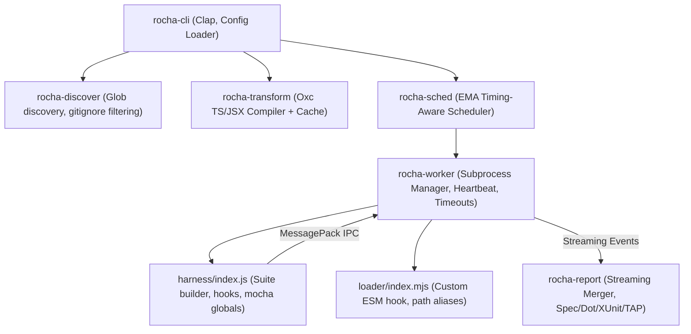

# Rocha Architecture Overview

Rocha combines a high-performance native orchestrator written in Rust with lightweight Node.js worker processes and a thin JS test harness.

## System Topology

---

## Core Crates and Components

### 1. `rocha-cli`
Handles command-line argument parsing with `clap`, configuration merging (`.mocharc.*`, `package.json`, `rocha.config.*`), error UX formatting matching Mocha error conventions, diagnostics (`--doctor`), and profiling (`--profile`).

### 2. `rocha-discover`
Performs parallel, multi-threaded directory traversal using the `ignore` crate. Respects `.gitignore`, filters hidden directories, resolves test globs, and performs cross-platform path normalization across Linux, macOS, and Windows.

### 3. `rocha-transform`
Provides native-speed TypeScript, JSX, and modern ECMAScript code transformations using [Oxc](https://github.com/oxc-project/oxc). Computes deterministic cache keys incorporating file contents, compiler flags, and tsconfig settings, persisting transformed bundles in `.rocha/cache/`.

### 4. `rocha-protocol`
Defines the binary IPC contract between the Rust orchestrator and the Node.js harness. Events are serialized as framed MessagePack packets with 4-byte little-endian length prefixes, enabling zero-copy streaming decoding.

### 5. `rocha-worker`
Supervises Node.js worker subprocesses over standard I/O pipes. Enforces orchestrator-side hard timeouts, handles graceful shutdown (`SIGTERM`/`SIGKILL`), and monitors process liveness.

### 6. `rocha-sched`
Implements longest-first scheduling with work stealing. Tracks historical execution runtimes in `.rocha/timings.json` and updates estimates using an Exponential Moving Average (EMA).

### 7. `rocha-report`
Merges interleaved event streams from multiple concurrent workers into a deterministic, file-ordered sequence. Implements native formatters for `spec`, `dot`, `min`, `list`, `tap`, `json`, `json-stream`, and `xunit` (Jenkins-compliant), as well as a bridge for custom JS reporters.

### 8. `rocha-watch`
Monitors filesystem changes with `notify` 6.1, debounce buffering, and AST import graph reverse-dependency traversal to rerun only affected test files. Supports interactive TTY keystroke controls.
